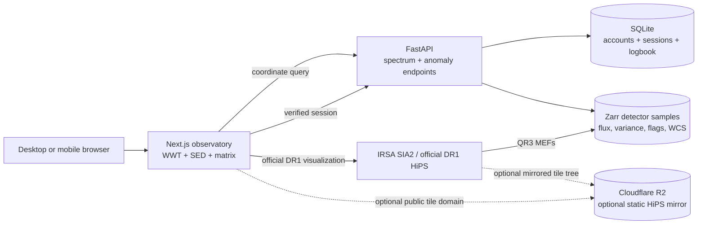

# Chronospectra

Chronospectra is a public-facing SPHEREx observatory prototype for comparing
near-infrared observations across time and wavelength. It combines WorldWide
Telescope (WWT), a FastAPI spectral API, and detector-preserving Zarr products
ingested from NASA/IPAC Infrared Science Archive (IRSA).

This repository contains the Phase 1 ingestion foundation and Phase 3/4
spectroscopy, anomaly-screening, UI, and deployment scaffolding. WWT
initialization and overlays are included in the frontend. The data browser
does not manufacture missing samples or claim that a statistical candidate
alone establishes a physical discovery.

The observatory now includes an original, responsive sky-explorer shell,
catalog search, WWT viewport controls, object details, and an account-backed
observation logbook. Authentication is intentionally fail-closed: public
registration requires a configured Cloudflare Turnstile site/secret pair, an
SMTP verification sender, and an encryption key for date-of-birth data.

## Architecture



```text
frontend/  Next.js App Router, WWT WebGL engine, Recharts, Lucide icons, UI
backend/   FastAPI endpoints, SQLite accounts/logbook, IRSA ingestion, Zarr
```

### Data-release boundary

IRSA's challenge resources identify QR3 and DR1 SPHEREx products. The QR3
spectral-image products are multi-extension FITS detector images, not a single
102-plane spectral cube per observation. The Phase 1 converter stores observed
per-pixel wavelength/bandwidth, flux, variance, flags, detector, and epoch in
Zarr. API responses contain only the samples actually present at the requested
pixel; a spectrum can have fewer than 102 usable samples.

The official all-sky HiPS cube currently displayed by WWT is a DR1
visualization layer. It is not a QR3 time series and should not be confused
with the science values in the QR3 Zarr store. The WWT engine reads the HiPS
properties document and its HEALPix PNG tiles directly; the optional
`NEXT_PUBLIC_HIPS_BASE_URL` setting can point to an R2 mirror. Mirroring is an
explicit storage operation, not part of the FastAPI deployment.

The final live SIA2 ingestion attempt in this checkout (2026-11-15) failed
while reading IRSA's capabilities endpoint with HTTP 502 from the configured
network proxy, before any target product query or download. No QR3 data was
verified or added by that attempt; synthetic products remain demo-only.

## The Dual-Axis Matrix

The matrix uses time (available observation epochs) for its horizontal axis
and measured wavelength samples for its vertical axis. Each cell represents
an observed epoch/wavelength sample; cell intensity shows relative absolute
flux, and flagged measurements have an outline. Select a cell or drag through
cells to choose the active epoch and wavelength for inspection. Epoch A and
Epoch B selectors choose the comparison curves for the SED chart. The
available samples are taken from the products, so the count may differ from
102 and missing epoch/band cells are not interpolated.

The SED chart shades the approximate H₂O-ice absorption region (2.85–3.15 μm)
and CO₂-ice region (4.20–4.34 μm). These areas annotate wavelength ranges,
not molecule detections. A deterministic client-side Cosmic Storyteller
summarizes the largest variance-based shift between the selected epochs; it
does not use a language model or assert a physical cause.

The shaded regions are visual annotations, not molecular detections. Wavelength
samples may have different coverage, calibration, flags, and bandpasses; the
chart matches samples only when their recorded bandpasses overlap. It does not
interpolate unobserved values.

## Quick start

### Requirements

- Node.js 20.9 or newer and npm.
- Python 3.12 recommended for the astronomy dependency stack.
- A local Phase 1 Zarr output at `backend/data/processed/zarr/` for non-empty
  spectra and anomaly results.
- Optional Cloudflare R2 bucket and API credentials when uploading a HiPS
  mirror or Phase 1 products.

### 1. Start the API

From the repository root in PowerShell:

```powershell
py -3.12 -m venv backend\.venv
backend\.venv\Scripts\Activate.ps1
python -m pip install -r backend\requirements.txt
python -m uvicorn backend.main:app --reload
```

If activating the virtual environment is blocked by local PowerShell policy,
invoke `backend\.venv\Scripts\python.exe` directly instead.

Useful endpoints:

| Endpoint | Purpose |
| --- | --- |
| `GET /health` | Liveness check |
| `GET /api/v1/layers` | Official WWT HiPS metadata |
| `GET /api/v1/spectra?ra_deg=...&dec_deg=...` | Nearest-pixel samples grouped by epoch |
| `GET /api/v1/anomalies?min_significance=5` | Epoch-differential candidates |
| `GET /api/v1/anomalies?epoch_a=...&epoch_b=...` | Candidates for the selected epoch pair |
| `POST /api/v1/auth/register` | CAPTCHA-checked account creation and verification email |
| `POST /api/v1/auth/verify-email` | Verify an email using its one-time token |
| `POST /api/v1/auth/login`, `POST /api/v1/auth/logout`, `GET /api/v1/auth/me` | Cookie-backed session lifecycle |
| `GET/POST /api/v1/observations` | List or save the signed-in user's observations |
| `PATCH/DELETE /api/v1/observations/{id}` | Edit notes or remove an owned observation |
| `DELETE /api/v1/auth/me` | Delete the signed-in account and cascade its observations/sessions |

Set `CHRONOSPECTRA_ZARR_ROOT` if the Zarr tree is mounted elsewhere.
`CHRONOSPECTRA_CORS_ORIGINS` is a comma-separated allowlist of browser origins;
do not use `*` with credentials.
`GET /api/v1/data-status` reports whether complete QR3 products are staged.
The sample `.env.example` files document the supported settings; the server
process needs those variables set in its environment (they are not loaded
automatically from a `.env` file).

#### Account and email configuration

The API stores profiles, hashed sessions, and observations in a local SQLite
database (`CHRONOSPECTRA_AUTH_DB`). Use a persistent disk for this database;
do not place the API on an ephemeral/serverless filesystem. Passwords are
salted scrypt hashes. Date of birth is encrypted with Fernet and is never
returned by the profile endpoint. Back up `CHRONOSPECTRA_PII_ENCRYPTION_KEY`
separately from the database; losing or rotating the key without an explicit
migration makes stored birth dates unreadable.

Generate a new encryption key and configure the required backend secrets in
the API host's environment:

```powershell
python -c "from cryptography.fernet import Fernet; print(Fernet.generate_key().decode())"
```

Set `CHRONOSPECTRA_TURNSTILE_SECRET_KEY` from Cloudflare Turnstile and put the
matching public site key in `frontend/.env.local` as
`NEXT_PUBLIC_TURNSTILE_SITE_KEY`. Registration is disabled until both sides
are set. Configure `CHRONOSPECTRA_SMTP_HOST`, `PORT`, `USER`, `PASSWORD`,
`FROM`, and `CHRONOSPECTRA_FRONTEND_URL` so registration can send its
24-hour verification link. SMTP STARTTLS is on by default.

For local development, set `CHRONOSPECTRA_COOKIE_SECURE=false` and
`CHRONOSPECTRA_COOKIE_SAMESITE=strict`. In production use HTTPS and set
`CHRONOSPECTRA_COOKIE_SECURE=true`. If the frontend and API are on different
sites, use `CHRONOSPECTRA_COOKIE_SAMESITE=none`, HTTPS, and an exact
`CHRONOSPECTRA_CORS_ORIGINS` allowlist. Add API rate limiting at the hosting
gateway before opening account endpoints to the public internet.

If the page reports that it cannot reach the API, verify `http://localhost:8000/health`
and keep the FastAPI process running in its own terminal. For a deployed frontend,
`NEXT_PUBLIC_API_BASE_URL` must be the reachable HTTPS API origin; `localhost`
always refers to the visitor's own computer.

### 2. Start the frontend

In a second terminal:

```powershell
Set-Location frontend
Copy-Item .env.example .env.local
npm install
npm run dev
```

Set `NEXT_PUBLIC_API_BASE_URL` to the reachable FastAPI origin. The frontend
uses the WWT WebGL engine's standard touch/pointer handling for pan and
pinch-to-zoom; its map click coordinates are translated to ICRS RA/Dec and
queried from the API. Clicking an anomaly pin moves the WWT camera to the
candidate and requests its spectrum. Sky clicks update the shareable URL;
opening a URL such as
`http://localhost:3000/?ra=133.795129&dec=-7.245147` flies to WISE 0855 and
requests a spectrum at that coordinate.

The map's **External survey** menu can layer the IRSA-hosted AllWISE RGB or
2MASS color HiPS images over SPHEREx. These are imaging references, not QR3
spectral data.

The account dialog collects name, email, date of birth, a 12-character-minimum
password, required terms/privacy consent, and a Turnstile challenge. Users must
verify email before signing in. The left logbook saves targets and notes to
the authenticated API; the API scopes every read/update/delete by account.
The map uses browser geolocation only after the browser's permission prompt,
and displays coordinates without sending them to a reverse-geocoding provider.
The bottom toolbar controls WWT grids, atmospheric horizon, cyan
constellation lines/art/labels, ecliptic/meridian guides, night-mode colors,
fullscreen, and the current field of view. Solar-system labels are provided by
WWT; the local catalog search includes reference entries and states when
catalog metadata is unavailable or approximate.

**Operational notice:** the included Privacy Policy & Terms page is a
prototype notice, not legal advice. Review and adapt it for the deployed
operator, jurisdiction, retention and deletion process before using real
personal data. Protect and back up the encryption key; secure the API with
HTTPS, a persistent private database, backups, and gateway rate limits.

### 3. Ingest data (Phase 1)

From the repository root after installing dependencies:

```powershell
python backend\src\ingest_spherex.py
```

The default products are written to `backend/data/raw/` and
`backend/data/processed/zarr/`. The official DR1 HiPS reference manifest is
written to `backend/data/processed/hips/`. Never commit downloaded science
data, generated Zarr stores, or credentials.

The app's data-readiness panel explains this command when the API has no
complete local QR3 products. WWT DR1 tiles still render without any local QR3
download; click-to-extract and the epoch anomaly scan become available after
the ingestion script finishes and the API's data status becomes ready.

The ingestion command queries IRSA when you run it; it does not monitor IRSA or
automatically discover future releases in the background. Re-run it when a new
release or collection is published and verify the returned products before
using them.

### Synthetic demo fallback

When live QR3 products are unavailable, generate a separate, schema-compatible
demo tree and exercise all five challenge targets, the wavelength slider,
epoch comparison, SED chart, and anomaly pins:

```powershell
python backend\src\mock_qr3_generator.py
```

By default this writes to
`backend/data/processed/zarr/mock-qr3/`, which the default API Zarr search
includes without overwriting downloaded products. The demo has 102 samples
per epoch and target, detector, variance, flags, spatial/spectral coordinates,
and HEALPix NESTED indices. Epsilon Indi B and WISE 0855 receive small synthetic
epoch-position offsets and injected flux changes so the radar has candidates
to display. Output is deterministic and can be regenerated in place.

**Every generated value is synthetic and is not an observation, calibration,
or result from NASA/SPHEREx.** The app labels demo products and pins as
synthetic. Never cite their fluxes or anomaly scores as scientific findings.
Use verified IRSA QR3 products for science or challenge evidence.

### Scheduled update workflow

`.github/workflows/spherex_updater.yml` queries the configured QR3 collection
monthly and can also be started from the GitHub Actions page with **Run
workflow**. The six-month wording refers to the scientific epoch size; monthly
polling checks for a newly published release rather than waiting six months.
Before enabling it, add GitHub Actions secrets named `R2_ACCOUNT_ID`,
`R2_ACCESS_KEY_ID`, `R2_SECRET_ACCESS_KEY`, and `R2_BUCKET`, scoped to a
dedicated bucket/key. The job installs `backend/requirements.txt`, runs the
IRSA ingester, and uses its `--upload-r2` option to upload processed Zarr
products and manifests.

The current ingester does **not** make a HiPS tile pyramid. It writes the
official SPHEREx HiPS reference manifest and the frontend loads the public
IRSA tiles directly. Do not copy third-party HiPS trees to R2 without
confirming the provider's redistribution terms. R2 therefore stores generated
science products, not a purported mirror of SPHEREx/AllWISE/2MASS tiles.

## Spectroscopy and anomaly screening

`GET /api/v1/spectra` uses the image spatial WCS from each complete Zarr group
to find the nearest pixel and returns flux, variance-derived uncertainty,
flags, detector, date, wavelength, and bandwidth. Invalid fluxes and
non-positive variances are omitted. Flags remain in the response for review;
the screening code does not reinterpret mission bit masks.

The anomaly endpoint pairs nearest measured wavelengths across two epochs,
checks overlap against the recorded bandwidths, and computes

```text
z = (flux_epoch_b - flux_epoch_a) / sqrt(variance_epoch_a + variance_epoch_b)
```

It reports the strongest per-target shift above the requested threshold. This
is a candidate-screening statistic: it does not yet include multiple-testing
correction, correlated calibration uncertainty, moving-source registration,
or a validated per-product quality-mask policy. The Cosmic Storyteller uses
cautious language and explicitly avoids treating a CO₂-band change as proof of
sublimation.
Changing Epoch A/B in the matrix refreshes the anomaly query with that exact
pair. The wavelength selector indexes the selected Epoch A samples, while the
SED chart independently overlays the samples from both chosen epochs.

## Track B physics helpers

`backend/src/ray_marcher.py` supports differentiable adaptive stepping and
per-ray capture masks. `integrate_geodesic(..., terminate_radius=2*mass,
return_active_mask=True)` returns position and momentum histories plus a
Boolean active-ray history; captured rays are clamped to the requested radius
and held fixed. Adaptive steps reduce each ray's step near `r = 3M` by a
configurable radius heuristic; disable them for fixed-step convergence studies.

`backend/src/losses.py` provides:

- `mhd_divergence_loss(B, spacing)`: scalar mean-squared `div(B)` on a
  `(batch, 3, depth, height, width)` field. It uses centered `conv3d` stencils
  internally and one-sided boundary differences.
- `project_magnetic_field_to_screen(B, direction, screen_basis=...)`: local
  projection into a 2D observer screen.
- `stokes_qu_from_magnetic_field(I, B, direction, ...)`: optically thin
  synchrotron Stokes Q/U emissivities from the projected field and a local
  Stokes-I emissivity.

For general-relativistic transfer, pass local-frame spatial field and ray
direction components, not raw coordinate four-momentum. Supply a
parallel-transported orthonormal screen basis to compare polarization angles
along curved rays. These helpers do not implement Faraday rotation, absorption,
or full polarized transfer; integrate Q/U with the transfer solver and validate
the basis transport before interpreting polarization maps scientifically.

## Theme and mobile behavior

The UI theme uses obsidian `#05050A`, telemetry cyan `#00F0FF`, amber
`#FFB703`, and a monospaced system stack beginning with JetBrains Mono. Layout,
controls, charts, dialog, and anomaly list reflow for narrow screens. WWT
receives touch gestures in its full-size map viewport (`touch-action: none`).
The chart uses keyboard-accessible native controls and honors reduced-motion
preferences for pulsing pins. The sky viewport uses a custom cyan cursor that
shifts to red in night mode. Projection overlays avoid redundant React updates
while the sky is stationary and pause their position polling when the tab is
hidden.

## Deployment

### Vercel frontend

1. Import the repository in Vercel and set **Root Directory** to `frontend`.
2. Keep the framework preset as Next.js. The checked-in `frontend/vercel.json`
   uses `npm ci` and `npm run build`; no extra rewrite or CORS proxy is needed.
3. Configure `NEXT_PUBLIC_API_BASE_URL` to the public HTTPS API base URL.
   Configure `NEXT_PUBLIC_TURNSTILE_SITE_KEY` with the public Cloudflare
   Turnstile site key.
4. Optionally set `NEXT_PUBLIC_HIPS_BASE_URL` to the public custom domain for
   the mirrored HiPS tree. These values are public browser configuration; do
   not put secrets in `NEXT_PUBLIC_*`.
5. Add the deployed Vercel origin to backend `CHRONOSPECTRA_CORS_ORIGINS`.

The FastAPI process and the Zarr store need a persistent backend host or mounted
volume; Vercel does not host this local filesystem API as configured.

### Render FastAPI backend

The root `render.yaml` is a Render Blueprint for a single-instance Docker
service. It builds `backend/Dockerfile`, checks `/health`, and mounts a 10 GB
persistent disk at `/var/data`. The image builds the explicitly synthetic demo
Zarr products separately; at first startup, they are copied onto an empty
persistent Zarr directory so the demo's SED and anomaly features work without
claiming to have NASA data. Existing non-empty Zarr storage is never
overwritten by this seed operation. Back up the disk and plan an explicit
verified-data migration before replacing demo products. The API-only
requirements omit the PyTorch,
IRSA-query, and HEALPix packages that are needed for model development and
ingestion but not for serving spectra; this reduces deployment build time and
image size. The monthly ingestion workflow continues to use the full
`backend/requirements.txt`.

Create the Render Blueprint from the repository root and fill its `sync: false`
environment variables in the Render dashboard:

| Variable | Value / where to get it |
| --- | --- |
| `CHRONOSPECTRA_CORS_ORIGINS` | Exact browser origin(s), e.g. `https://chronospectra.example.org`; comma-separated only if needed. No wildcard. |
| `CHRONOSPECTRA_FRONTEND_URL` | Full deployed frontend URL, e.g. `https://chronospectra.example.org`. |
| `CHRONOSPECTRA_TURNSTILE_HOSTNAMES` | Exact hostnames allowed by your Turnstile widget, e.g. `chronospectra.example.org`; no scheme or path. Add preview hostnames only if you intend to accept registrations there. |
| `CHRONOSPECTRA_TURNSTILE_SECRET_KEY` | Cloudflare Turnstile **secret** key. The frontend receives only the matching site key. Server validation checks the CAPTCHA success, hostname, and `signup` action. |
| `CHRONOSPECTRA_PII_ENCRYPTION_KEY` | A new Fernet key generated with the command below. Back it up securely; do not rotate without migrating encrypted data. |
| `CHRONOSPECTRA_SMTP_HOST` | SMTP provider hostname. |
| `CHRONOSPECTRA_SMTP_USER` / `CHRONOSPECTRA_SMTP_PASSWORD` | SMTP credentials stored as Render secrets. |
| `CHRONOSPECTRA_SMTP_FROM` | Verified sender address. |

The Blueprint sets `CHRONOSPECTRA_AUTH_DB=/var/data/chronospectra.sqlite3`,
`CHRONOSPECTRA_ZARR_ROOT=/var/data/processed/zarr`, TLS-secure cookies, and
SMTP port 587 with STARTTLS. It binds to Render's `$PORT` (falling back to 8000
for local Docker). Keep this deployment to one API instance while using SQLite
and its attached disk. The attached volume is not shared across replicas.

For Vercel and Render's default `*.vercel.app` and `*.onrender.com` domains,
the Blueprint uses `SameSite=None; Secure`; some browsers restrict cross-site
cookies. For reliable account sessions, attach both services to the same
registrable domain (for example `app.example.org` and `api.example.org`),
configure the exact CORS origin, and verify cookies in the target browsers.
Before horizontal scaling, migrate sessions and observations to a shared
database such as managed PostgreSQL.

Generate the PII encryption key locally; never commit the output:

```powershell
python -c "from cryptography.fernet import Fernet; print(Fernet.generate_key().decode())"
```

Set these additional **Vercel** variables:

| Variable | Value |
| --- | --- |
| `NEXT_PUBLIC_API_BASE_URL` | Render API HTTPS origin, with no trailing path, e.g. `https://chronospectra-api.onrender.com`. |
| `NEXT_PUBLIC_TURNSTILE_SITE_KEY` | Cloudflare Turnstile public site key for the production hostname. |
| `NEXT_PUBLIC_HIPS_BASE_URL` | Optional public HiPS mirror URL; omit it to use the public IRSA URL. |

Set `R2_ACCOUNT_ID`, `R2_ACCESS_KEY_ID`, `R2_SECRET_ACCESS_KEY`, and
`R2_BUCKET` as **GitHub Actions secrets** for the scheduled ingestion workflow,
not as `NEXT_PUBLIC_*` values. R2 uploads are not automatically synchronized
to the Render disk: the live API reads local Zarr files. Add a controlled
download/sync step or an R2-backed Zarr adapter before expecting uploaded
products to appear in API responses. Keep the R2 bucket private unless you
have a specific, audited public-serving use case.

The deployment files configure infrastructure only; they do not create
provider accounts, DNS records, credentials, or live deployments. Review
Cloudflare Turnstile's domain allowlist, SMTP sender authorization, Vercel
environment scope, and Render disk persistence before accepting registrations.

### Recommended hosting layout

1. **Frontend:** deploy `frontend/` to Vercel. Set
   `NEXT_PUBLIC_API_BASE_URL` to the public HTTPS address of the API, not
   `localhost`. Set `NEXT_PUBLIC_HIPS_BASE_URL` only if you operate an
   authorized, compatible HiPS mirror; otherwise the default public IRSA URL
   is used.
2. **API:** deploy `backend/` to a Python service that supports FastAPI and
   persistent storage (for example, a small container service plus a mounted
   volume). Configure `CHRONOSPECTRA_CORS_ORIGINS` with the exact Vercel domain
   and `CHRONOSPECTRA_ZARR_ROOT` with the mounted data path. Keep `/health`
   available for deployment health checks.
3. **Product storage:** the scheduled GitHub job uploads processed Zarr
   products to a private R2 bucket using least-privilege S3-compatible
   credentials. The current API reads local/mounted Zarr, not R2 directly;
   add an R2 download/synchronization step on the API host or an R2-backed
   Zarr store adapter before expecting scheduled updates to appear in the
   live API. Preserve the separation between deployed API storage and
   synthetic demo data.
4. **Tiles/CDN:** at present WWT requests tiles from public IRSA. This avoids
   maintaining a very large duplicate tile tree. If a rights-cleared HiPS
   dataset is mirrored to R2 later, serve it through a Cloudflare custom
   domain, preserve the HiPS paths and metadata, verify CORS and sample tile
   requests, and only then set `NEXT_PUBLIC_HIPS_BASE_URL`. R2 egress is free
   within Cloudflare, but storage, operations, domain and compute costs can
   still apply.

The celestial search matches catalog names, aliases, and categories, and also
supports anomaly candidates returned by the API. An empty search does not
select a default target; pressing Enter selects the first visible match.

### Challenge-phase status checklist

- **Phase 1 — foundation and ingestion:** Next.js/FastAPI scaffolding,
  IRSA SIA2 ingestion, detector-level Zarr conversion, and metadata handling
  are implemented. An attempted live query previously returned no products;
  verify the current collection and product coverage before presenting live
  science. Local HiPS *generation* from FITS is not implemented; WWT uses the
  external official HiPS service instead.
- **Phase 2 — map and temporal/spectral controls:** WWT loads SPHEREx DR1 HiPS,
  supports map gestures and external AllWISE/2MASS image overlays. The matrix
  displays available sample cells and supports cell selection. A local
  epoch-specific HiPS tile pipeline, synchronized side-by-side epoch maps,
  and blinking comparison are not implemented.
- **Phase 3 — spectroscopy and anomaly radar:** coordinate extraction,
  two-epoch SED comparison, flags, and variance-based variable-target
  screening are implemented and covered by tests. Moving-object/asteroid
  association (including a Moving Object Search Tool integration),
  supernova classification, and robust scientific quality/completeness
  corrections are not implemented. Demo anomalies are synthetic and labeled.
- **Phase 4 — polish and deployment:** responsive theme, touch map controls,
  URL coordinate links, and deployment configuration are present. Vercel,
  API hosting, R2 secrets/bucket synchronization, and production DNS must be
  configured in the project owner accounts; this repository does not deploy
  itself.

### Cloudflare R2 tiles

1. Create a private R2 bucket and, if tiles should be public, attach a dedicated
   custom domain such as `tiles.example.org`. Do not expose the S3 API key in
   frontend variables.
2. Mirror the complete public IRSA HiPS tree while preserving its path layout
   and `properties` file. Validate sample tile URLs and browser CORS before
   changing `NEXT_PUBLIC_HIPS_BASE_URL`.
3. Configure a read-only public bucket/custom domain for those static tiles;
   keep write credentials scoped to a backend ingestion identity.
4. For the Phase 1 script's optional Zarr upload, configure these backend-only
   environment variables: `R2_ACCOUNT_ID`, `R2_ACCESS_KEY_ID`,
   `R2_SECRET_ACCESS_KEY`, and `R2_BUCKET`.
5. The current Phase 3 API reads a local/mounted Zarr directory. For a
   serverless or horizontally scaled deployment, either mount a shared
   persistent volume or add an R2-backed Zarr store adapter and caching layer.
   The Zarr groups are not served directly from the browser.

### Production checks

```powershell
Set-Location frontend
npm run typecheck
npm run lint
npm run build
Set-Location ..
python -m unittest discover -s backend\tests -v
```

## Project roadmap recommendations

### Physics and ray rendering

- The integrator supports per-ray termination masks and optional event-horizon
  clipping with `terminate_radius=2*mass`; request `return_active_mask=True`
  when the renderer should hide captured rays. Adaptive steps reduce the step
  near the photon sphere (about `r = 3M` for Schwarzschild) and are a visual
  heuristic, not a local-error estimate.
- The current null projection adjusts `p⁰`; for precision work where
  Schwarzschild's Killing energy must be conserved, use smaller unprojected
  steps with null-residual and energy monitoring, or implement an
  energy-preserving constraint method. Compare convergence under step
  refinement before presenting scientific results.
- The new Stokes and divergence helpers are foundations only. Add a validated
  local tetrad, parallel-transported screen basis, polarized transfer terms
  (including Faraday effects where applicable), and boundary-condition-aware
  MHD losses before treating Q/U maps as scientific measurements.
- Use an embedded error estimate or step-doubling controller near unstable
  photon orbits, and use stable per-ray masks rather than allowing one ray to
  abort a GPU batch.

### Next science and product phases

1. **Calibrated SED extraction:** Respect the mission's spectral calibration
   products, per-pixel bandpasses, contamination flags, PSF/aperture correction,
   and correlated uncertainty. Keep display products separate from science
   products.
2. **Completeness-aware anomaly ranking:** Add robust epoch aggregation,
   quality masks, background/systematic uncertainty, cross-epoch source
   association for moving objects, and false-discovery-rate correction across
   thousands of pixels/channels.
3. **Temporal coverage and provenance:** Show missing epochs and channel
   coverage explicitly; include release, processing version, detector, and
   source-file provenance in every chart/export.
4. **Scalable data access:** Add a spatial index and metadata catalog for Zarr
   groups, then benchmark co-located reads and a bounded cache before scaling
   to large target catalogs.
5. **Accessible observatory UX:** Add a keyboard-only map workflow, screen
   reader summaries for chart values, a contrast/reduced-motion check, and
   explicit loading/error states for unavailable archive epochs.
6. **Deployment resilience:** Add rate limits, request timeouts, observability,
   object-store integrity checks, reproducible data manifests, and an
   automated staging deploy that exercises both API and tile URLs.

## Challenge and archive references

- [NASA Space Apps: Planet X and SPHEREx](https://www.spaceappschallenge.org/2026/challenges/planet-x-and-spherex/)
- [Challenge resources](https://www.spaceappschallenge.org/2026/challenges/planet-x-and-spherex/?tab=resources)
- [IRSA SPHEREx Archive](https://irsa.ipac.caltech.edu/Missions/spherex.html)
- [SPHEREx tutorial notebooks](https://caltech-ipac.github.io/irsa-tutorials/spherex/)
- [WiseView](http://byw.tools/wiseview) — WISE time-domain visualization inspiration, as listed by the challenge.
- [Gaia mission data (DR3)](https://archive.stsci.edu/missions-and-data/gaia) — use the latest release, as recommended by the challenge.
- [SPHEREx data products](https://caltech-ipac.github.io/spherex-archive-documentation/spherex-data-products/)
- [WorldWide Telescope WebGL engine](https://github.com/WorldWideTelescope/wwt-webgl-engine)

## License

This project is released under the MIT License; see [LICENSE](./LICENSE).
